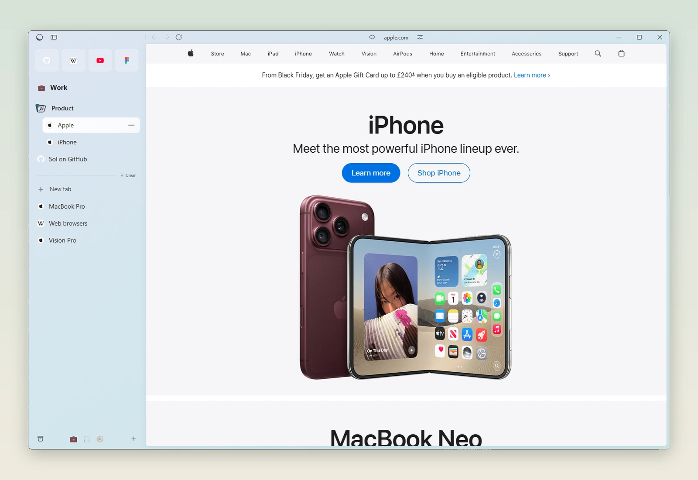
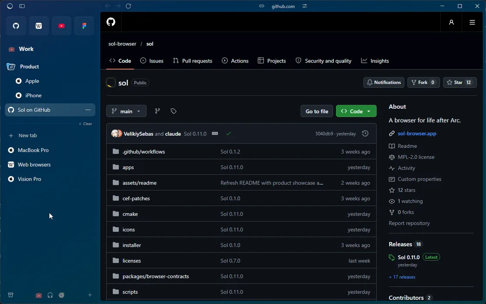
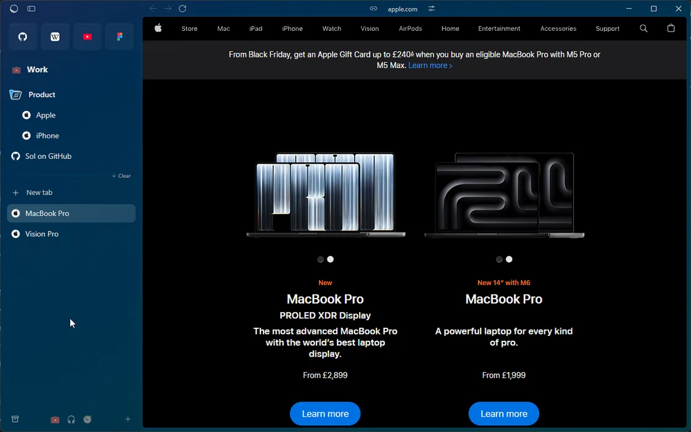

<p align="center">
  
</p>

<h1 align="center">Sol</h1>

<p align="center"><strong>A browser for life after Arc.</strong></p>
<p align="center">Your spaces. Your tabs. A little more room to breathe.<br>Made for Windows, built around Spaces and a sidebar.</p>

<p align="center">
  <a href="https://github.com/sol-browser/sol/releases/latest/download/Sol-Web-Installer.exe"></a>
</p>

<p align="center"><sub>Windows 11 · x64 · Open source · Beta</sub></p>

<p align="center"><sub>Available in English and Ukrainian. <a href="https://translate.sol-browser.app/engage/sol-browser/">Help translate Sol into your language</a> on Weblate.</sub></p>

<p align="center">
  <a href="https://sonarcloud.io/summary/new_code?id=sol-browser_sol"></a>
  <a href="https://sonarcloud.io/summary/new_code?id=sol-browser_sol"></a>
  <a href="https://sonarcloud.io/summary/new_code?id=sol-browser_sol"></a>
  <a href="https://sonarcloud.io/summary/new_code?id=sol-browser_sol"></a>
  <a href="https://translate.sol-browser.app/engage/sol-browser/"></a>
</p>

<p align="center">
  <a href="#a-place-for-every-part-of-your-day">Spaces</a>
  &nbsp; · &nbsp; <a href="#up-to-four-pages-one-train-of-thought">Split View</a>
  &nbsp; · &nbsp; <a href="#follow-the-link-keep-your-place">Link Peek</a>
  &nbsp; · &nbsp; <a href="#everything-in-one-place">Library</a>
  &nbsp; · &nbsp; <a href="#from-arc-to-sol">Compare with Arc</a>
  &nbsp; · &nbsp; <a href="CHANGELOG.md">Changelog</a>
  &nbsp; · &nbsp; <a href="https://sol-browser.app">Website</a>
</p>

<picture>
  <source media="(prefers-color-scheme: dark)" srcset="assets/readme/cover-dark.webp">
  
</picture>

##  A place for every part of your day

Work, a side project, a rabbit hole. Each Space keeps its own tabs, icon and
theme, so you can pick up where you left off.

Favorites keep the everyday close. Folders and Pinned tabs hold what stays,
and each folder takes on its Space's color, with an icon if you like.
Today gives everything else a place, with automatic archiving.


##  Up to four pages. One train of thought.

Keep your notes beside a reference, compare pages or follow along while you
work. Split View puts two, three or four tabs side by side in any arrangement.
Drag a tab to the edge of a page to add it, drag the dividers to resize, and
move a pane by its header or drop it on the sidebar to take it out.


##  Follow the link. Keep your place.

Links from Pinned tabs and Favorites to another site open in a preview above
the page. A quick detour can stay a preview, become a full tab or join your
page in a split.



##  Everything in one place

Library lays out every Space side by side, each in its own color. Rename,
re-theme or reorder Spaces, and drag tabs and folders between them. The
Archive keeps closed tabs from every Space by day, ready to search and restore.



##  Links that land in the right place

Little Sol opens a single page in a compact window of its own, from Sol or
from any app, for a quick look without leaving what you were doing.

Air Traffic Control decides where links from other apps open. Send a meeting
link to Little Sol, a work tool to your Work Space and everything else to the
Space you used last, with rules you can edit in Settings or Library.

##  Make it your space

A name, an icon and a palette for each Space. Shape the colors, brightness
and grain, with light and dark themes and Windows Acrylic and Mica materials.


##  Work and personal, on your terms

Profiles keep logins, history, passwords and extensions separate. A profile can
belong to several Spaces, so your browsing stays connected where you want it.

##  Everything else you need

- **Command bar:** search the web, your open tabs and history, or a site directly.
- **Integrations:** hover a pinned Gmail, Outlook, Google Calendar or Figma tab
  for unread mail, today's agenda or recent files; WhatsApp and X show unread badges.
- **Page translation:** translate pages on your device, with no text sent to a server.
- **Media:** Picture-in-Picture and media controls in the sidebar; Netflix,
  Spotify and other streaming services with the optional Streaming DRM module.
- **Screenshots:** capture a region, the visible page or the whole page.
- **Passwords:** saving, autofill and passkeys.
- **Extensions and blocking:** Chrome extensions, and uBlock Origin built in.
- **Boosts:** restyle any site with your own CSS.
- **Sync:** your Spaces, pins and passwords on every PC, through your own cloud folder.
- And the basics: downloads, Chrome's print preview and keyboard shortcuts you can change.

## From Arc to Sol

Arc's familiar workflow, brought to Windows. Here's how Sol compares with
Arc for macOS, including its signature features.

| Feature | Sol | Arc (macOS) |
| :--- | :---: | :---: |
| Spaces and themes | ✓ | ✓ |
| Favorites, pins and folders | ✓ | ✓ |
| Automatic tab archiving | ✓ | ✓ |
| Split View | ✓ | ✓ |
| Link Peek / Peek | ✓ | ✓ |
| Little Arc | ✓ (Little Sol) | ✓ |
| Separate browsing profiles | ✓ | ✓ |
| Command bar and tab search | ✓ | ✓ |
| Picture-in-Picture | ✓ | ✓ |
| Chrome extensions | ✓¹ | ✓ |
| Website styling (CSS Boosts) | Not polished | ✓ |
| JavaScript Boosts | No | ✓ |
| Easels | No | ✓ |
| GitHub Live Folders | No | ✓ |
| Air Traffic Control | ✓ | ✓ |
| AI tools / Arc Max | No | ✓ |
| Browser account required | No | Yes |
| Sync across devices | Beta² | Arc Sync |
| Built-in ad blocker | Beta³ | Via extensions |
| Protected streaming (Netflix, Spotify) | Experimental⁴ | ✓ |

**Not polished**: available, with rough edges.

¹ Chrome extension support is nearly complete, with work planned on the remaining
compatibility gaps.

² Spaces, Pinned tabs, Favorites and saved passwords sync between your PCs through your own
OneDrive, Dropbox or Google Drive folder, encrypted with your passphrase; no account. Today tabs
stay on each PC.

³ uBlock Origin is built in and managed in Settings > Ad blocker, with per-site control in the
site panel.

⁴ Streaming DRM is off by default. When you turn it on in Settings, Sol downloads a separate
component, [castLabs ECS](https://github.com/sol-browser/streaming-drm) signed for Widevine, and plays
Netflix, Spotify and other protected services in their tabs through it. Saved passwords, passkeys,
autofill and extensions are not available in those tabs.

<details>
<summary>Comparison scope and Arc sources</summary>

This compares the current Sol build on Windows with Arc for macOS.
Feature availability does not imply identical behavior.

Arc references: [macOS release notes](https://resources.arc.net/hc/en-us/articles/20498293324823-Arc-for-macOS-2024-2026-Release-Notes),
[2023 macOS release notes](https://resources.arc.net/hc/en-us/articles/20498377604887-Arc-for-macOS-2023-Release-Notes)
and [feature and account FAQ](https://resources.arc.net/hc/en-us/articles/44413577819159-Arc-Sunset-Frequently-Asked-Questions).
Arc availability reflects November 2026; The Browser Company has announced
[Arc's sunset on December 22, 2026](https://resources.arc.net/hc/en-us/articles/44412972248471-Arc-Sunset-Key-Dates-and-What-to-Expect).

</details>

##  Bring your browser with you

Your next browser doesn't have to start from scratch. Sol supports import from
Chrome, Edge, Arc and Zen, along with bookmark files and password CSVs.

<p align="center"><strong>Chrome &nbsp; · &nbsp; Edge &nbsp; · &nbsp; Arc &nbsp; · &nbsp; Zen</strong></p>

## Try Sol

<p align="center">
  <a href="https://github.com/sol-browser/sol/releases/latest/download/Sol-Web-Installer.exe"></a>
</p>

The web installer downloads Sol and installs it for your Windows account.
No administrator rights are needed. Installed copies check for updates and
show **Restart to update** when a new version is ready.

A full offline installer, `Sol-Setup-<version>.exe`, is also available on the
[Releases page](https://github.com/sol-browser/sol/releases/latest).

Sol is in beta for **Windows 11 x64**. Windows builds are currently unsigned.

<details>
<summary>Platform and extension compatibility</summary>

Windows 10 is untested. Linux and macOS are not supported yet.
Extension compatibility varies; CEF Chrome Runtime does not guarantee every
Chrome API works.

</details>

## A few shortcuts

| Action | Shortcut |
| :--- | :--- |
| Open the command bar / edit the address | <kbd>Ctrl</kbd> + <kbd>T</kbd> / <kbd>Ctrl</kbd> + <kbd>L</kbd> |
| Show or hide the sidebar | <kbd>Ctrl</kbd> + <kbd>S</kbd> |
| Pin the current tab | <kbd>Ctrl</kbd> + <kbd>D</kbd> |
| Switch to the next tab | <kbd>Ctrl</kbd> + <kbd>Tab</kbd> |
| Reopen the last closed tab | <kbd>Ctrl</kbd> + <kbd>Shift</kbd> + <kbd>T</kbd> |
| Open Settings | <kbd>Ctrl</kbd> + <kbd>,</kbd> |

Many shortcuts can be changed in Settings.

## A browser of our own

I built Sol for myself, around the way I like to browse.
I'm sharing it because you might want a browser you can make your own, too.

If that sounds like you, come build with me. Add a feature you've been missing,
improve the details, or help shape what comes next.

[Share an idea](https://github.com/sol-browser/sol/issues) · [Start contributing](#for-developers)

## For developers

<details>
<summary><strong>Build, tests and repository layout</strong></summary>

### Build from source

Sol combines a C++20 native host, a React/TypeScript interface and CEF Chrome Runtime.

You will need Windows 11 x64, Visual Studio 2022 or later with **Desktop
development with C++** and the Windows SDK, Python 3.12+, and Node.js 22.12+.
The build uses Visual Studio's bundled CMake and Ninja.

```powershell
./scripts/build.ps1
```

The script downloads the pinned prebuilt CEF engine, verifies its SHA-256,
installs UI dependencies with `npm ci`, builds the UI and native host, and runs
the CTest, Node and Python unit checks. Allow several GB of disk space.

```powershell
./build/Release/apps/desktop/Release/sol.exe --workspace
```

Sol uses a [maintained CEF fork](https://github.com/sol-browser/cef/tree/sol-158).
The exact binary is pinned in [cmake/cef.lock.json](cmake/cef.lock.json), and
[prebuilt engine releases](https://github.com/sol-browser/cef/releases) are
available separately. Building the app does not require a Chromium checkout.
Engine development uses `scripts/build_cef.ps1` and a full checkout.

Browser data lives in `%LOCALAPPDATA%\Sol\User Data`.
Use `--profile-dir=<absolute path>` for a separate data directory.
The Chromium sandbox remains enabled; Sol refuses `--no-sandbox` and
`--disable-web-security`.

### Tests and repository layout

Unit checks run as part of the build. To run the interface and protocol tests
on their own:

```powershell
node --experimental-strip-types --test tests/*.test.mjs
```

Native integration checks open real windows against local fixtures and write
reports to the ignored `artifacts/` directory. They take the foreground while
they run, so start them when you are not using the PC:

```powershell
python scripts/smoke.py
python scripts/workspace_smoke.py
python scripts/spaces_smoke.py
```

| Path | Contents |
| :--- | :--- |
| `apps/desktop` | C++20 native host: windows, tabs, storage and engine integration |
| `apps/browser-ui` | React, strict TypeScript and Vite browser interface |
| `apps/installer` | Native Windows web installer |
| `packages/browser-contracts` | Typed messages between the interface and host |
| `cmake` | Pinned dependencies, including the engine |
| `scripts` | Build, packaging and integration checks |
| `tests` | Unit tests: `tests/*.test.mjs` for the interface, `tests/native` for the host |
| `cef-patches` | History of the engine patches, now kept in the CEF fork |
| `assets/readme` | Screenshots, the feature tour and capture notes |

For media reproduction, see [the capture notes](assets/readme/README.md).

</details>

## License

Sol is licensed under the [Mozilla Public License 2.0](LICENSE).
Changes to MPL-covered files must remain available under the MPL.
Third-party components retain their [own licenses](THIRD_PARTY.md).

Sol is an independent project, not affiliated with The Browser Company.
