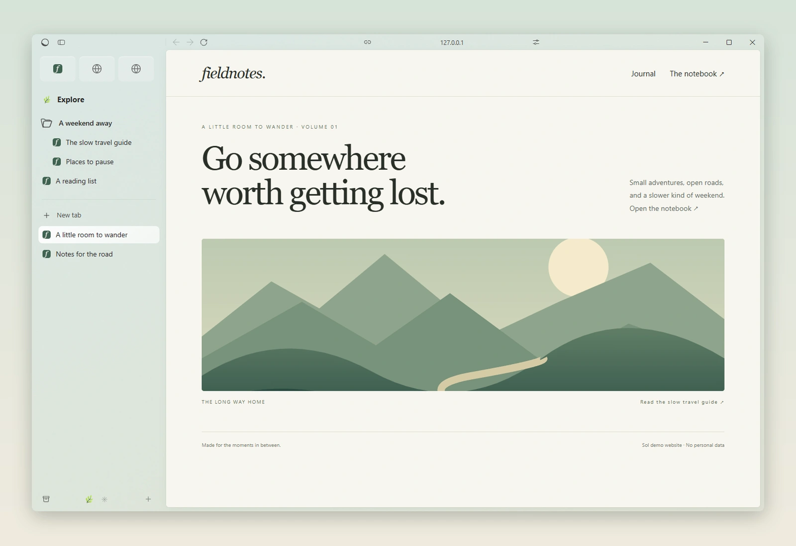
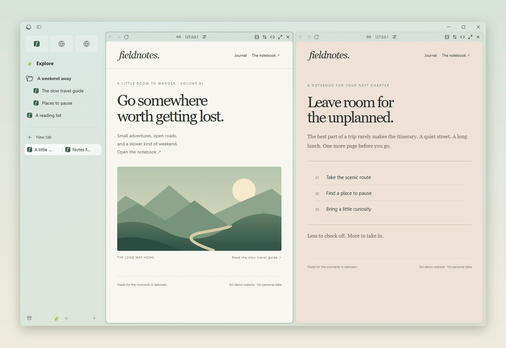
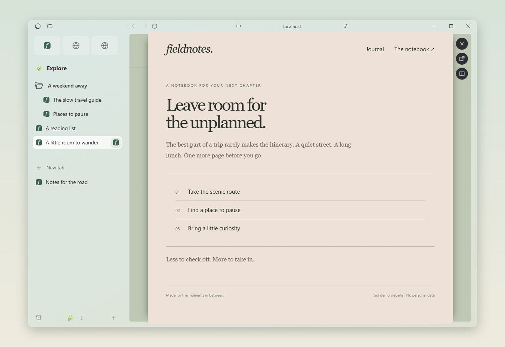
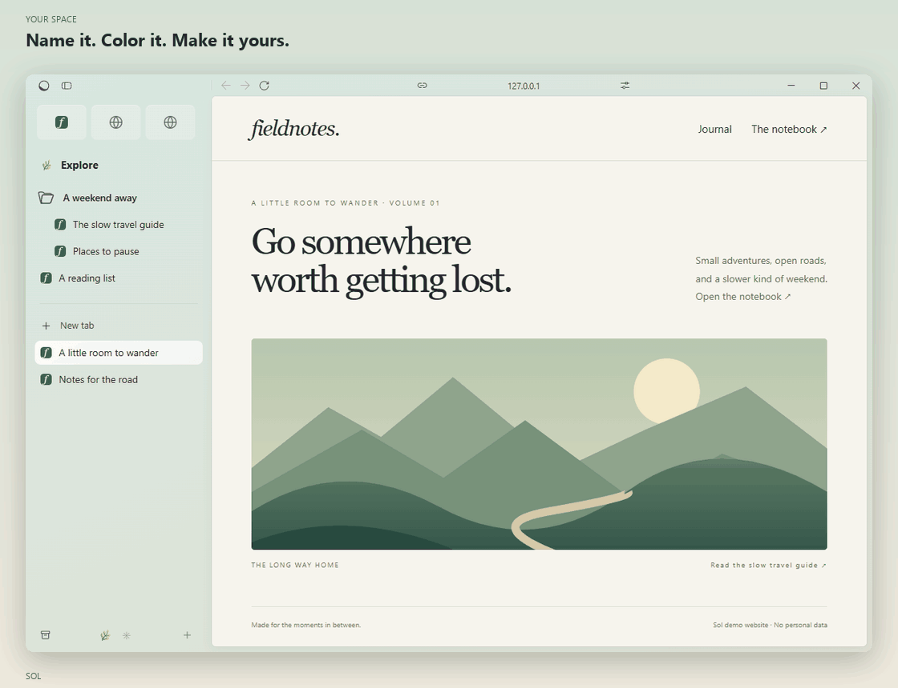
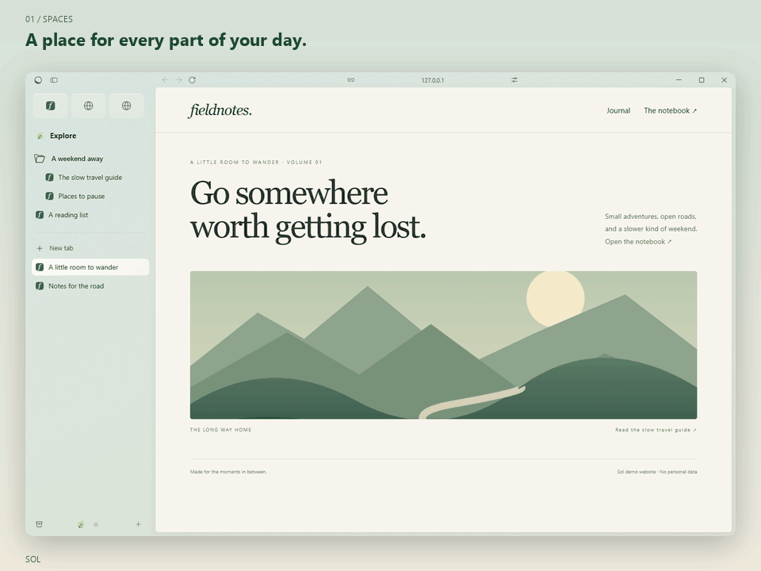

<p align="center">
  
</p>

<h1 align="center">Sol</h1>

<p align="center"><strong>A browser for life after Arc.</strong></p>
<p align="center">Your spaces. Your tabs. A little more room to breathe.<br>A browser for Windows, built around Spaces and a sidebar.</p>

<p align="center">
  <a href="https://github.com/sol-browser/sol/releases/latest/download/Sol-Web-Installer.exe"></a>
</p>

<p align="center"><sub>Windows 11 · x64 · Open source</sub></p>

<p align="center">
  <a href="#a-place-for-every-part-of-your-day">Spaces</a>
  &nbsp; · &nbsp; <a href="#two-pages-one-train-of-thought">Split View</a>
  &nbsp; · &nbsp; <a href="#follow-the-link-keep-your-place">Link Peek</a>
  &nbsp; · &nbsp; <a href="#from-arc-to-sol">Compare with Arc</a>
  &nbsp; · &nbsp; <a href="#see-it-in-motion">Watch the tour</a>
  &nbsp; · &nbsp; <a href="CHANGELOG.md">Changelog</a>
</p>

<picture>
  <source media="(prefers-color-scheme: dark)" srcset="assets/readme/cover-dark.webp">
  
</picture>

##  A place for every part of your day

Work, a side project, a rabbit hole. Each Space keeps its own tabs, icon and
theme, so you can pick up where you left off.

Favorites keep the everyday close. Folders and Pinned tabs hold what stays.
Today gives everything else a place, with automatic archiving.

##  Two pages. One train of thought.

Keep your notes beside a reference, compare two pages or follow along while
you work. Split View gives both pages room in the same window.



##  Follow the link. Keep your place.

Link Peek opens links from pinned tabs in a preview above the page. A quick
detour can stay a preview, become a full tab or join your page in a split.



##  Make it your space

A name, an icon and a palette for each Space. Shape the colors, brightness
and grain, with light and dark themes and Windows Acrylic and Mica materials.



##  Work and personal, on your terms

Profiles keep logins, history, passwords and extensions separate. A profile can
belong to several Spaces, so your browsing stays connected where you want it.

The everyday essentials are here too: a command bar for the web, open tabs
and history; Picture-in-Picture and sidebar media controls; Chrome extensions;
downloads; password saving and autofill; and Chrome's print preview.

## From Arc to Sol

Arc's familiar workflow, brought to Windows. Here's how Sol compares with
Arc for macOS, including its signature features.

| Feature | Sol | Arc (macOS) |
| :--- | :---: | :---: |
| Spaces and themes | ✓ | ✓ |
| Favorites, pins and folders | ✓ | ✓ |
| Automatic tab archiving | ✓ | ✓ |
| Split View | Not polished | ✓ |
| Link Peek / Peek | ✓ | ✓ |
| Separate browsing profiles | ✓ | ✓ |
| Command bar and tab search | Not polished | ✓ |
| Picture-in-Picture | Not polished | ✓ |
| Chrome extensions | ✓¹ | ✓ |
| Website styling (CSS Boosts) | Not polished | ✓ |
| JavaScript Boosts | No | ✓ |
| Easels | No | ✓ |
| Little Arc | No | ✓ |
| GitHub Live Folders | No | ✓ |
| Air Traffic Control | No | ✓ |
| AI tools / Arc Max | No | ✓ |
| Browser account required | No | Yes |
| Tab sync across devices | No | Arc Sync |

**Not polished**: available, with rough edges.

¹ Chrome extension support is nearly complete, with work planned on the remaining
compatibility gaps.

<details>
<summary>Comparison scope and Arc sources</summary>

This compares the current Sol build on Windows with Arc for macOS.
Feature availability does not imply identical behavior.

Arc references: [macOS release notes](https://resources.arc.net/hc/en-us/articles/20498293324823-Arc-for-macOS-2024-2026-Release-Notes),
[2023 macOS release notes](https://resources.arc.net/hc/en-us/articles/20498377604887-Arc-for-macOS-2023-Release-Notes)
and [feature and account FAQ](https://resources.arc.net/hc/en-us/articles/44413577819159-Arc-Sunset-Frequently-Asked-Questions).
Arc availability reflects November 2026; The Browser Company has announced
[Arc's sunset on December 22, 2026](https://resources.arc.net/hc/en-us/articles/44412972248471-Arc-Sunset-Key-Dates-and-What-to-Expect).

</details>

##  Bring your browser with you

Your next browser doesn't have to start from scratch. Sol supports import from
Chrome, Edge, Arc and Zen, along with bookmark files and password CSVs.

<p align="center"><strong>Chrome &nbsp; · &nbsp; Edge &nbsp; · &nbsp; Arc &nbsp; · &nbsp; Zen</strong></p>

## See it in motion

<details>
<summary><strong>Watch the 15-second tour</strong></summary>



</details>

<p align="center"><sub>Preview of the current development build.</sub></p>

## Try Sol

<p align="center">
  <a href="https://github.com/sol-browser/sol/releases/latest/download/Sol-Web-Installer.exe"></a>
</p>

The web installer downloads Sol and installs it for your Windows account.
No administrator rights are needed. Installed copies check for updates and
show **Restart to update** when a new version is ready.

A full offline installer, `Sol-Setup-<version>.exe`, is also available on the
[Releases page](https://github.com/sol-browser/sol/releases/latest).

Sol is early software for **Windows 11 x64**. Windows builds are currently unsigned.

<details>
<summary>Platform and extension compatibility</summary>

Windows 10 is untested. Linux and macOS are not supported yet.
Extension compatibility varies; CEF Chrome Runtime does not guarantee every
Chrome API works.

</details>

## A few shortcuts

| Action | Shortcut |
| :--- | :--- |
| Open the command bar / edit the address | <kbd>Ctrl</kbd> + <kbd>T</kbd> / <kbd>Ctrl</kbd> + <kbd>L</kbd> |
| Show or hide the sidebar | <kbd>Ctrl</kbd> + <kbd>S</kbd> |
| Pin the current tab | <kbd>Ctrl</kbd> + <kbd>D</kbd> |
| Switch to the next tab | <kbd>Ctrl</kbd> + <kbd>Tab</kbd> |
| Reopen the last closed tab | <kbd>Ctrl</kbd> + <kbd>Shift</kbd> + <kbd>T</kbd> |
| Open Settings | <kbd>Ctrl</kbd> + <kbd>,</kbd> |

Many shortcuts can be changed in Settings.

## A browser of our own

I built Sol for myself, around the way I like to browse.
I'm sharing it because you might want a browser you can make your own, too.

If that sounds like you, come build with me. Add a feature you've been missing,
improve the details, or help shape what comes next.

[Share an idea](https://github.com/sol-browser/sol/issues) · [Start contributing](#for-developers)

## For developers

<details>
<summary><strong>Build, tests and repository layout</strong></summary>

### Build from source

Sol combines a C++20 native host, a React/TypeScript interface and CEF Chrome Runtime.

You will need Windows 11 x64, Visual Studio 2022 or later with **Desktop
development with C++** and the Windows SDK, Python 3.12+, and Node.js 22.12+.
The build uses Visual Studio's bundled CMake and Ninja.

```powershell
./scripts/build.ps1
```

The script downloads the pinned prebuilt CEF engine, verifies its SHA-256,
installs UI dependencies with `npm ci`, builds the UI and native host, and runs
the CTest, Node and Python unit checks. Allow several GB of disk space.

```powershell
./build/Release/apps/desktop/Release/sol.exe --workspace
```

Sol uses a [maintained CEF fork](https://github.com/sol-browser/cef/tree/sol-156).
The exact binary is pinned in [cmake/cef.lock.json](cmake/cef.lock.json);
the [prebuilt engine release](https://github.com/sol-browser/cef/releases/tag/engine-156.0.31)
is available separately. Building the app does not require a Chromium checkout.
Engine development uses `scripts/build_cef.ps1` and a full checkout.

Browser data lives in `%LOCALAPPDATA%\Sol\User Data`.
Use `--profile-dir=<absolute path>` for a separate data directory.
The Chromium sandbox remains enabled; Sol refuses `--no-sandbox` and
`--disable-web-security`.

### Tests and repository layout

Unit checks run as part of the build. Native integration checks open real
windows against local fixtures and write reports to the ignored `artifacts/`
directory:

```powershell
python scripts/smoke.py
python scripts/workspace_smoke.py
python scripts/spaces_smoke.py
```

| Path | Contents |
| :--- | :--- |
| `apps/desktop` | C++20 native host: windows, tabs, storage and engine integration |
| `apps/browser-ui` | React, strict TypeScript and Vite browser interface |
| `apps/installer` | Native Windows web installer |
| `packages/browser-contracts` | Typed messages between the interface and host |
| `cmake`, `cef-patches` | Pinned dependencies and engine patch history |
| `scripts`, `tests` | Build, packaging and verification |
| `assets/readme` | Screenshots, the feature tour and capture notes |

For media reproduction, see [the capture notes](assets/readme/README.md).

</details>

## License

Sol is licensed under the [Mozilla Public License 2.0](LICENSE).
Changes to MPL-covered files must remain available under the MPL.
Third-party components retain their [own licenses](THIRD_PARTY.md).

Sol is an independent project, not affiliated with The Browser Company.
